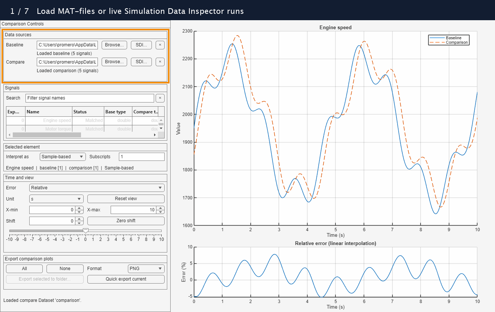

# Simulation Comparison App

[](https://github.com/mathworks/Simulation-Comparison-App/actions/workflows/main.yml)

Simulation Comparison App is a MATLAB&reg; app for exploring and comparing
signals in two Simulink&reg; datasets (`Simulink.SimulationData.Dataset`)
loaded from MAT-files, current Simulation Data Inspector (SDI) runs, or saved
SDI sessions.



## Highlights

- Load a baseline and comparison from MAT-files, live SDI runs, or saved
  `.mldatx` sessions.
- Find signals quickly with fuzzy search and distinguish matched,
  single-source, ambiguous, and unsupported entries.
- Inspect scalar elements from multidimensional samples or expand frame-based
  data into a scalar stream.
- Overlay source traces, view relative or absolute error, shift the comparison
  in time, and keep both plots on one synchronized time range.
- Customize legend labels and export selected comparisons to PNG, JPEG, TIFF,
  PDF, or SVG.
- Automate repeatable exports with `exportSimulationComparisonPlots`.

## How It Differs from Simulation Data Inspector

[Simulation Data Inspector](https://www.mathworks.com/help/simulink/slref/simulationdatainspector.html) provides a broad environment for viewing logged
signals and [comparing simulation runs](https://www.mathworks.com/help/simulink/ug/compare-simulation-data.html)
against numerical tolerances. Simulation Comparison App complements SDI with a focused workflow for exploring individual
signal differences, aligning measurements, and preparing plots for engineering
discussions. You can use existing SDI runs or saved sessions directly as data
sources.

- **Direct comparison with incremental error computation per signal.** Select
  a signal to see its baseline and comparison traces together with its relative
  or absolute error. The app computes numerical errors for that signal on
  demand, then computes the next signal's errors when you select it. This avoids
  the overhead of a full run comparison that evaluates all matched signals,
  including signals you are not interested in. For long simulations or very
  small time steps, a full run comparison in SDI can take minutes before its
  comparison plots are ready. Computing errors only for the selected signal
  lets you focus that work on the data you need; loading data and processing
  a large individual signal still take time.

- **One time shift for the full signal set.** Align a transient in one signal
  and reuse the same comparison time offset as you browse the other signals
  or export multiple plots. The offset applies to both the source traces and
  the error computation, keeping all comparisons on a consistent time basis.
  This is especially useful for comparing simulations with real-world
  measurements whose recording start times or event timing vary between runs.
  For example, align a load step once, then inspect the corresponding speed,
  torque, and current responses with the same shift.

- **Multiple plot exports with descriptive annotations and custom legends.**
  Select several signals and export an individual two-panel comparison plot
  for each in one operation. Exports include descriptive signal and element
  titles, time and error labels, and custom legend entries such as
  **Measured** and **Simulated**, while sharing the chosen time shift and view
  limits. These annotations identify the data and comparison context directly
  in the figures. This makes it easier to illustrate engineering discussions
  with consistent simulation evidence and reduces the need to capture and
  manually label screenshots in Microsoft&reg; Paint, Snagit&reg;, or similar
  tools. The `exportSimulationComparisonPlots` API also makes repeated exports
  easy to automate.

## Public API

| Category | Function | Description |
|---|---|---|
| Apps | `runSimulationComparisonApp` | Open the comparison app, optionally with MAT-files or current SDI runs preloaded. |
| Export | `exportSimulationComparisonPlots` | Export selected signal comparisons without opening the app. |

## Installation

The app requires MATLAB R2024b or later and Simulink.

An installable `.mltbx` toolbox package is available from the GitHub&reg;
repository's [**Releases**](https://github.com/mathworks/Simulation-Comparison-App/releases) section. Download the installer for the desired release
and open it in MATLAB to install the toolbox directly; cloning the Git&trade;
repository is not required.

Packaged releases display their version in the app title and check for a newer
stable GitHub release in the background when the app starts. If one is available,
choose **Download** to open its release page or **Later** to continue.
Development checkouts do not perform this check. Pass `CheckForUpdates=false`
to `runSimulationComparisonApp` to disable it explicitly.
The check uses GitHub's public API without credentials. Unavailable releases,
network failures, and API rate limits are ignored silently.

## Getting Started

Open an empty app:

```matlab
app = runSimulationComparisonApp;
```

Open the app with a baseline and comparison file:

```matlab
app = runSimulationComparisonApp( ...
    BaselineFile="baseline.mat", ...
    CompareFile="comparison.mat");
```

Open the app with two current SDI runs:

```matlab
app = runSimulationComparisonApp( ...
    BaselineRunID=baselineRunID, ...
    CompareRunID=comparisonRunID);
```

Each MAT-file must contain at least one
`Simulink.SimulationData.Dataset` variable. When a file contains multiple
datasets, the app prompts you to choose one.

To select existing SDI data interactively, click **SDI...** beside either
source. The chooser refreshes from the current SDI repository and identifies
each run by name, run ID, and signal count. The selected run is copied into
the app as a Dataset, so the comparison remains valid if that SDI run is
subsequently removed.

To load runs from an exported SDI session, click **Browse...**, select the
`.mldatx` file, and then choose one of the imported runs. The app imports the
session without opening SDI and leaves runs already in the current SDI
repository intact.

Click the **×** button beside either source to clear it. The signal table and
plots immediately refresh from the remaining source, or clear completely when
neither source remains selected.

Fixed-point comparison requires an available Fixed-Point Designer&trade;
license.
When no license is available, the app displays a warning and keeps fixed-point
signals visible in the signal table with an unavailable note. Standard MATLAB
numeric and logical signals remain comparable.

## Comparing Signals

Signals are matched by name. The signal table includes the union of names from
both sources and identifies uniquely matched, baseline-only, comparison-only,
ambiguous, and unsupported entries. Supported single-source signals can be
inspected on the source plot; relative or absolute error is available when
both sources contain one supported signal with that name.

Logged virtual and non-virtual buses are expanded recursively into their leaf
signals. Each leaf appears in the table and public API under a dotted name such
as `Bus.Measurement` or `Bus.Controller.Measurements.Value`. These names support
the same search, element selection, plotting, comparison, and export operations
as ordinary logged signals, whether the source is a MAT-file or an SDI run.

Signals use **Sample-based** interpretation by default. For vector or
multidimensional samples, enter one-based element subscripts such as `2` or
`2,3`. Choose **Frame-based** when each logged value is a frame: the app
expands the frame elements into one scalar stream before plotting and
comparison. Frame-based conversion requires at least two distinct frame
timestamps and disables element selection.

Use the time-unit, X-limit, and shift controls to align the source traces.
Positive shifts move the comparison trace to the right. The lower plot
evaluates the comparison on baseline timestamps within the shifted overlap.
Choose **Relative** error for:

```text
100 * (comparison - baseline) / abs(baseline)
```

Choose **Absolute** error for:

```text
abs(comparison - baseline)
```

Near-zero baseline values appear as gaps for relative error. Unavailable
interpolated samples appear as gaps for either type. The source and error
plots share their X limits. The selected error type persists when signals or
datasets change. You can also right-click either plot to set an X boundary or
reset the view; the source plot additionally offers point-based time alignment
and legend editing.

## Exporting Comparison Plots

In the app, check the `Export` column for the signals you want, choose PNG,
JPEG, TIFF, PDF, or SVG, and click **Export selected to folder...**. Each
signal is written as an individual two-panel comparison plot in the selected
folder. App exports preserve the current time unit, time shift, X limits, and
the active element and interpretation of the displayed signal. Other selected
signals use their first element with sample-based interpretation. Right-click
the source plot and choose **Edit legend labels...** to use meaningful names
such as **Reference** and **Candidate** in the app and exported figures.
App exports always identify each line as `datasetName | legendLabel`, including
when the legend still uses its default **Baseline** and **Comparison** labels.

To export only the currently displayed signal without choosing a folder,
click **Quick export current**. The app writes the plot to the current MATLAB
folder in the selected format. This also works for a supported single-source
signal.

The same workflow is available without opening the app:

```matlab
files = exportSimulationComparisonPlots( ...
    "baseline.mat", "comparison.mat", ...
    Signals=["speed", "torque"], ...
    OutputFolder="comparison-plots", ...
    Format="png", ...
    ErrorType="Absolute", ...
    BaselineLegendText="Reference", ...
    CompareLegendText="Candidate");
```

An empty `Signals` option exports every uniquely matched, supported signal.
The function creates the output folder if needed and returns the generated
file paths. Use `BaselineDatasetName` and `CompareDatasetName` to select
variables without a prompt. `TimeUnit`, `TimeShiftSeconds`, `XLimits`, and
`Resolution` control the exported view. `ErrorType` accepts `Relative` (the
default) or `Absolute`. `BaselineLegendText` and
`CompareLegendText` control the `legendLabel` portion of
`datasetName | legendLabel`; they default to **Baseline** and
**Comparison**.

For an already loaded app, export with its current view settings through the
returned ViewModel:

```matlab
files = app.viewModel.exportSignals( ...
    ["speed", "torque"], "comparison-plots", "svg");
```

## Development

Run the default build:

```matlab
buildtool
```

The default task runs Code Analyzer, the test suite, and coverage reporting.
To create an installable toolbox package:

```matlab
buildtool package("1.0.0")
```

The version is supplied at build time so the same value can be used for the
corresponding Git tag.
